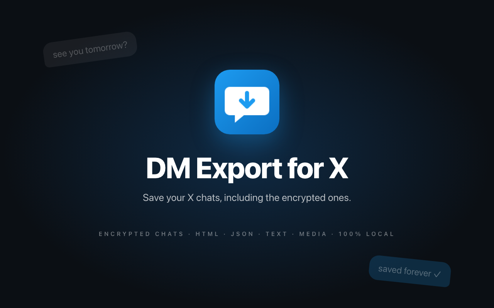
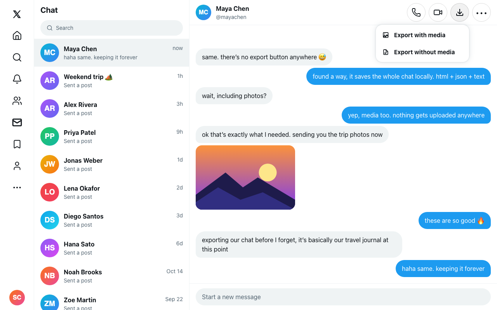
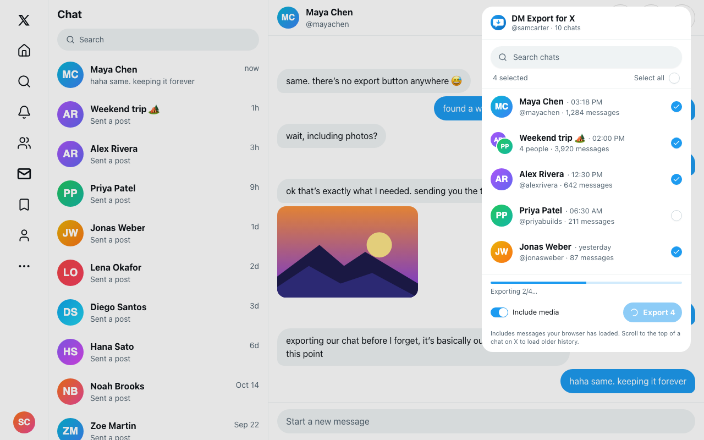
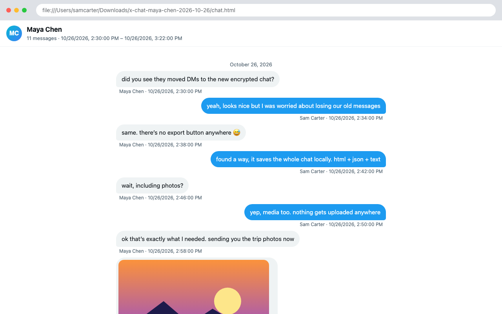

<div align="center">


# DM Export for X

**Export your X (Twitter) DMs, including the new end-to-end encrypted chats, in one click.**

<sub>X moved DMs to encrypted Chat and left no way to save them. DM Export for X reads the chats your browser already decrypted and turns them into files you keep: a readable HTML page, JSON and plain text, with photos and videos.</sub>

<p>
  <a href="https://github.com/Jubstaaa/x-dm-export/releases/latest"></a>
  <a href="LICENSE"></a>
  <a href="https://github.com/Jubstaaa/x-dm-export/stargazers"></a>
</p>

<p>
  <a href="https://github.com/Jubstaaa/x-dm-export/releases/latest"></a>
</p>

</div>

<p align="center">
  
</p>

---

## What it does

DM Export for X is a Chrome extension that saves your X chats to your computer. Open a conversation and click the download button next to the call buttons, or select any number of chats from the toolbar and export them all at once.

Built for anyone who doesn't want years of conversations to live only inside X: keeping memories, backing up work threads, or leaving the platform.

## Features

- **Encrypted chats supported**: works with X's new end-to-end encrypted Chat, plus older DMs
- **Export button inside X**: sits next to the call buttons and looks like part of X. Choose _with media_ or _without media_
- **Bulk export**: search your chats, select any or all, get one zip with a folder per chat
- **Three formats in every export**
    - `chat.html`: a readable chat view with bubbles, dates, reactions and media, light and dark
    - `chat.json`: every message with sender, timestamp, reactions and media paths
    - `_chat.txt`: plain text, one line per message as `[date, time] Name: message`
- **Photos, GIFs and videos** your browser has downloaded, saved next to the chat
- **Group chats** with participant names and avatars
- **Zero data collection**: no servers, no accounts, no analytics, no network requests

<p align="center">
  
</p>

<p align="center">
  
</p>

<p align="center">
  
</p>

## How it works

X's encrypted chats are decrypted inside your browser, so tools that read X's network traffic only ever see ciphertext. But X's web app keeps a local SQLite database of your chats in the browser's Origin Private File System:

```
backups/chat_<your user id>.db               decrypted messages, users, reactions
dm-files-<your user id>/decrypted-media-v2/  decrypted photos and videos
```

The extension's content script runs on `x.com`, opens that database with [sql.js](https://github.com/sql-js/sql.js), and builds the zip in the page with [fflate](https://github.com/101arrowz/fflate). It reads only the message, user, reaction and attachment tables. It never touches the tables X uses for encryption keys.

The in-chat button is a clone of X's own call button, so it matches X exactly in light and dark mode.

**Limitation:** an export contains what X has synced to this browser. For a chat's full history, open it on x.com and scroll up to the beginning first.

## Install

### From GitHub releases

1. Download the latest `x-dm-export-vX.Y.Z.zip` from [Releases](https://github.com/Jubstaaa/x-dm-export/releases/latest) and unzip it
2. Open `chrome://extensions` and enable **Developer mode** (top-right toggle)
3. Click **Load unpacked** and select the unzipped folder

Works on any Chromium-based browser (Chrome, Edge, Brave, Arc).

### From source

```bash
git clone git@github.com:Jubstaaa/x-dm-export.git
cd x-dm-export
bun install
bun run build
```

Then load the `dist/` folder as an unpacked extension.

## Development

```bash
bun install
bun run dev        # Vite dev server + HMR (dist/ auto-rebuilds)
bun run build      # Production build → dist/
bun run typecheck  # tsc -b --noEmit
bun run lint
```

Store screenshots are rendered from fake data, never real chats:

```bash
bunx vite --config store/screens/vite.config.ts   # open /?scene=hero|chat|popup|export|tile
```

## Tech stack

| Layer        | Tools                                                            |
| ------------ | ---------------------------------------------------------------- |
| Build        | Vite, [@crxjs/vite-plugin](https://crxjs.dev), Bun               |
| UI           | React 19, TypeScript, Tailwind CSS v4                            |
| Components   | shadcn/ui (new-york), Radix UI, lucide-react                     |
| Data         | sql.js (SQLite → WASM), cbor-x, fflate                           |
| Browser APIs | Origin Private File System, `chrome.tabs`, `chrome.runtime`, MV3 |

## Project structure

Flat per-feature folders. Each feature owns its component, types, and a colocated hooks file when the logic outgrows the component.

```
src/
├── content/                     Runs on x.com
│   ├── content.tsx              Entry: popup message handlers + header button mount
│   ├── content.css              Tailwind for the shadow-root overlay
│   ├── export-menu.tsx          In-chat export menu anchored to the cloned X button
│   └── x-chat-page.ts           Finds X's chat header, current chat id, page theme
├── popup/                       Toolbar popup
│   ├── popup.tsx                JSX wiring
│   ├── popup.hooks.ts           useChatExporter: tab IPC, selection, progress
│   ├── popup.constants.ts       Empty-state copy
│   ├── chat-row.tsx             X-style chat row with avatars
│   ├── empty-state.tsx
│   └── export-footer.tsx        Progress, media switch, export button
├── lib/
│   ├── chat-storage.ts          OPFS access (database + media)
│   ├── chat-database.ts         sql.js queries → typed chats and messages
│   ├── chat-render.ts           HTML, JSON and text renderers
│   ├── chat-archive.ts          Zip building and download
│   └── chrome-messaging.ts      Typed popup ↔ content messages
├── components/
│   ├── x-icons.tsx              X-style icon set
│   ├── export-status-icon.tsx   Idle / exporting / done / error icon
│   └── ui/                      shadcn primitives + X-style menu
├── theme.css                    X color tokens (light + dark)
└── main.tsx                     Popup entry

public/                          Manifest icons (16/32/48/128)
store/                           Chrome Web Store assets + screens/ demo renderer
```

## Privacy

DM Export for X does not collect, transmit, or store any data. Everything happens in your browser, and the export is saved to your Downloads folder. No analytics. No telemetry. No accounts. See [PRIVACY.md](PRIVACY.md).

## Disclaimer

Not affiliated with or endorsed by X Corp. The extension reads data X stores in your own browser; if X changes that storage, it may need an update. Please [open an issue](https://github.com/Jubstaaa/x-dm-export/issues) if something breaks.

## License

MIT

---

<div align="center">

If DM Export for X saved your chats, ⭐ this repo. It really helps.

</div>
